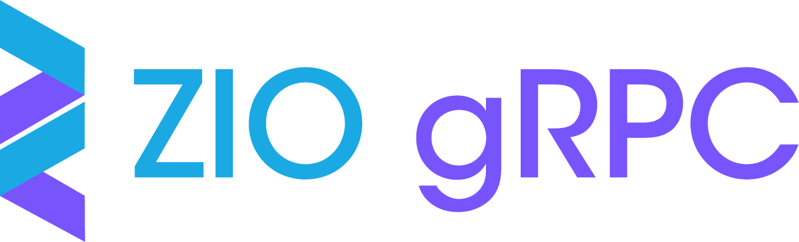

[Snapshot artifacts](https://central.sonatype.com/repository/maven-snapshots/com/thesamet/scalapb/zio-grpc/)

# Welcome to ZIO-gRPC

This library enables you to write purely functional [gRPC](https://grpc.io/) services using [ZIO](https://zio.dev).

## Documentation

* [ZIO gRPC homepage](https://scalapb.github.io/zio-grpc)
* [Changelog](CHANGELOG.md)

## Highlights

* Supports all types of RPCs (unary, client streaming, server streaming, bidirectional).
* Uses ZIO's `Stream` to let you easily implement streaming requests.
* Cancellable RPCs: client-side ZIO interruptions are propagated to the server to abort the request and save resources.

## Development

Scala 3 stays on the 3.3 LTS line. CI tests Scala 2.12, 2.13 and 3.3 on JDK 11,
with an additional JDK 21 job. Node 24 and Yarn 1.22.22 are used for JavaScript
and documentation builds.

Run `nix-shell` for the pinned development toolchain (JDK 21), or
`nix-shell playwright.nix` for the same environment with matching Chromium
binaries. Both use the revision and checksum in `nix/nixpkgs.json`; update those
together when refreshing Nixpkgs. The Playwright version assertion catches
browser/Java dependency mismatches.

Run `.github/workflows/test_examples.sh` to publish the checkout under a private
local version and compile/test all examples against it. Ordinary example builds
continue to use the published version declared in their `project/plugins.sbt`.

For browser integration tests, start Envoy with
`docker compose -f examples/fullapp/docker-compose.yaml up -d --wait`, then run
`sbt e2eWebJS2_13/fastOptJS/webpack e2eWebJVM2_13/test` inside the Playwright Nix
shell. Outside Nix, first run `PLAYWRIGHT_INSTALL_DEPS=true sbt e2eWebJVM2_13/installPlaywright` on a supported Linux distribution. Stop Envoy
with `docker compose -f examples/fullapp/docker-compose.yaml down` afterward.
Replace `2_13` with `2_12` or `3` for the other Scala versions.

## Publishing

CI must pass for the exact commit before the reusable release workflow runs.
Pushes to `master` publish snapshots; `v*` tags publish releases. Documentation
is deployed from validated `master` commits in a separate job.

The repository (or organization with access granted to this repository) needs
`SONATYPE_USERNAME` and `SONATYPE_PASSWORD` containing a Central Portal user token,
plus `PGP_SECRET` and `PGP_PASSPHRASE` for signing. `DEPLOY_KEY` is the separate
SSH credential for documentation deployment. A successful snapshot publish is
the integration check for the Portal credentials; inspect the publish job and
resolve the resulting artifacts before tagging a release. Snapshots are hosted
at `https://central.sonatype.com/repository/maven-snapshots/`.
